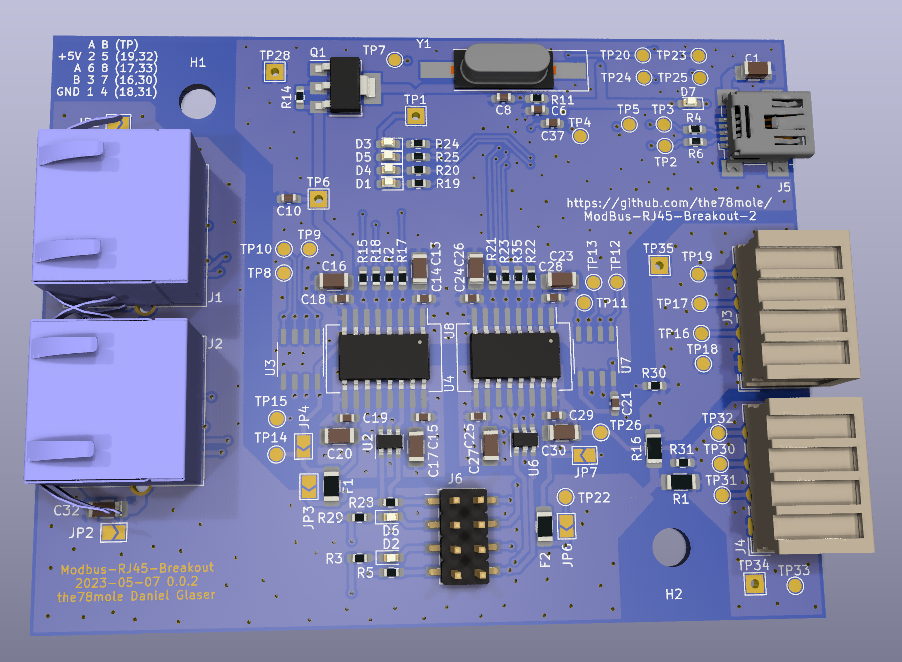
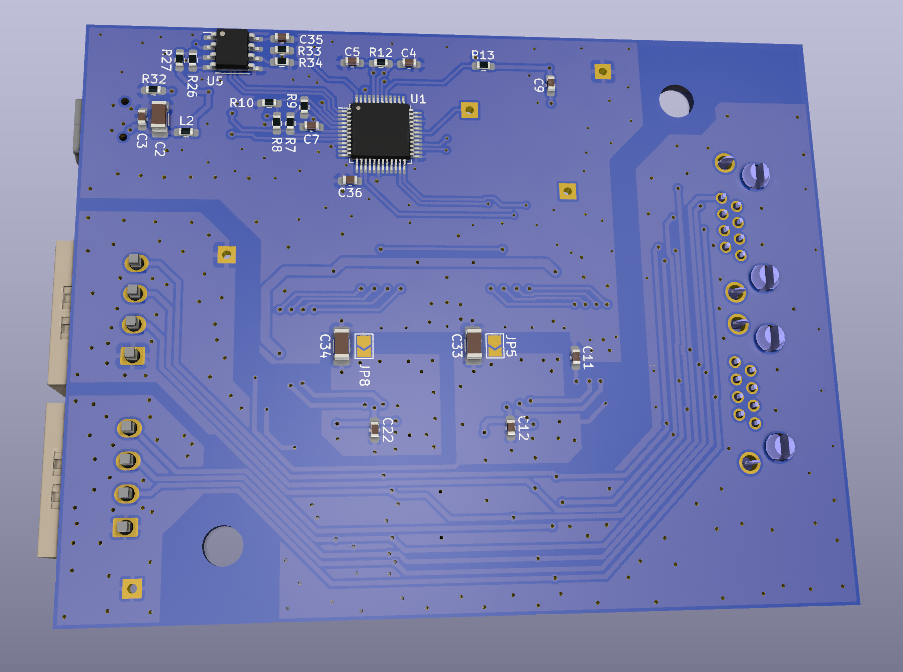
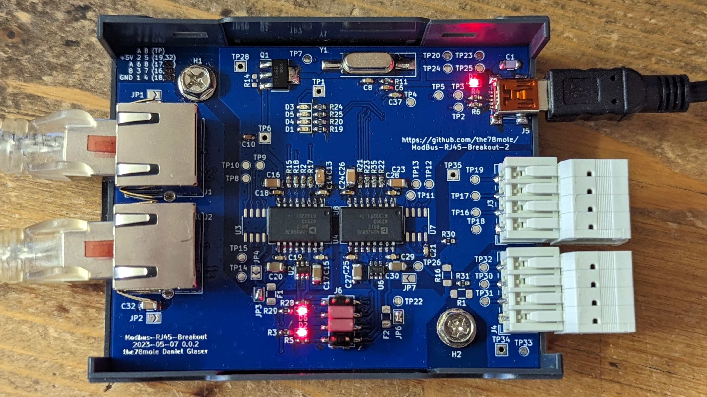
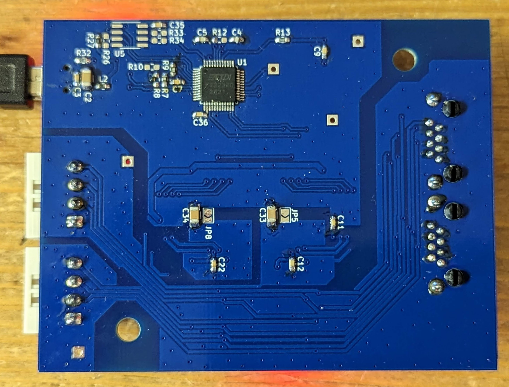
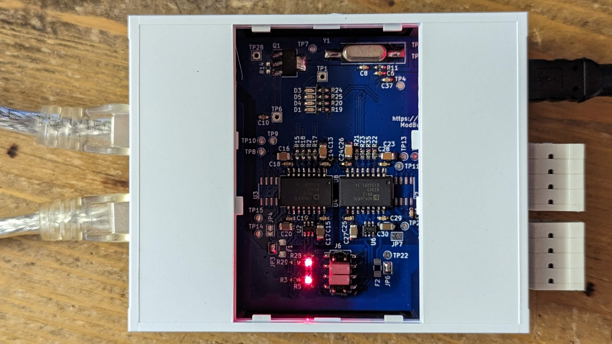

# Modbus-RJ45-Breakout
A breakout board for Dual-ModBus-over-Twisted-Pair (RJ45) with isolated converters option




Here are some images of the first prototype, assembled with isolating RS485 transceivers. Echo already works, real testing on a ModBus will take place soon.





## Production Files

This repository includes an automated workflow that generates production-ready files for PCB manufacturing and assembly. The workflow creates:

- **Gerber Files** - Ready for PCB manufacturer submission
- **Drill Files** - For via and hole drilling
- **Schematic PDF** - Complete circuit documentation
- **Interactive BOM** - HTML component placement guide
- **3D STEP Model** - For mechanical design verification
- **PCB Renders** - Professional visualizations and assembly drawings

### Using the Production Workflow

The workflow automatically runs on:
- Every push to `main` branch
- Every pull request
- Manual trigger via "Actions" tab

**For Pull Requests:** Download artifacts directly from the workflow run to review changes.

**For Releases:** Production files are automatically attached to GitHub releases with semantic versioning.

### Manual Generation

To generate production files locally, ensure you have the required tools installed and run:

```bash
.github/scripts/generate-production-files.sh
```

Files will be generated in the `production/` directory.
